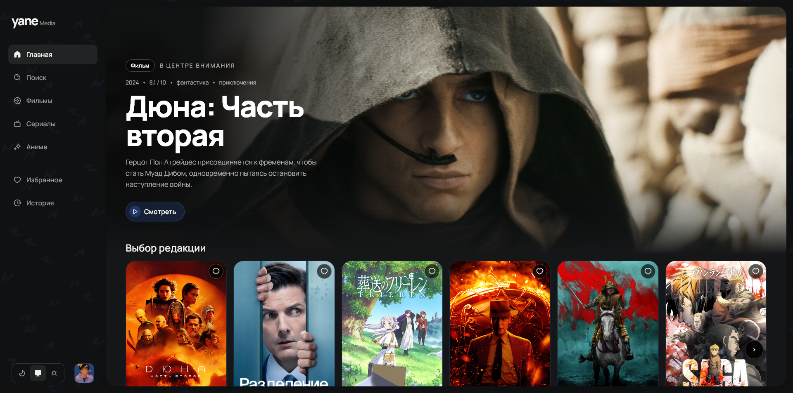
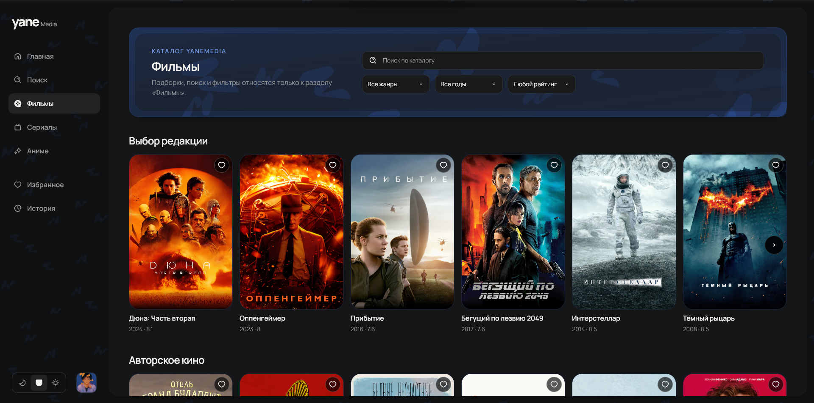
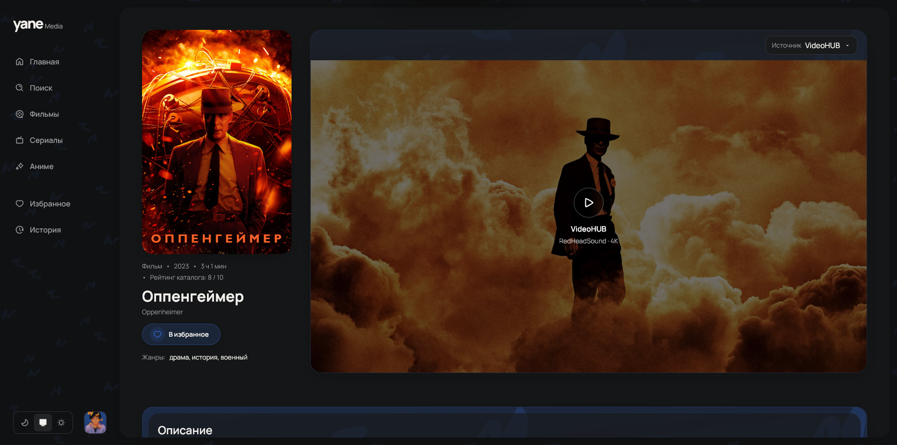
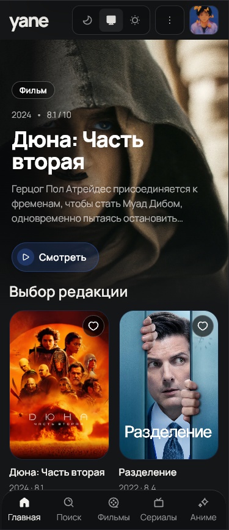

# yaneMedia

Фильмы, сериалы и аниме в одном приложении: найдите, что посмотреть, выберите источник и продолжайте с того места, где остановились.



- Каталог, поиск, подборки и фильтры.
- Выбор источника, серий, озвучки и субтитров, когда они доступны.
- Избранное, история просмотра и сохранение прогресса.
- Оценки, отзывы и профили пользователей.
- Светлая и тёмная темы, интерфейс для компьютера и телефона.

<details>
<summary>Ещё скриншоты</summary>

Главная в светлой теме:


Каталог фильмов:



Страница фильма:



Мобильная версия:



</details>

## Быстрый старт

Нужен Docker с Compose **2.24.4 или новее**. Корень проекта — папка скачанного или склонированного репозитория, в которой лежит `compose.yaml`. Откройте терминал в этой папке. В примерах ниже она обозначена как `yaneMedia/`.

1. Скопируйте настройки:

   ```sh
   # Папка: yaneMedia/ (корень проекта)
   cp backend/.env.example backend/.env
   ```

2. В `backend/.env` укажите `TMDB_API_KEY` для каталога и ключи нужных источников из примера. Почта необязательна: без `RESEND_API_KEY` и `MAIL_FROM` приложение работает для гостей. Для регистрации и отправки писем заполните оба значения.

3. Выберите режим: **Home** — с torrent на вашем сервере, **Public** — без серверного torrent. Для первого запуска Home есть [короткая пошаговая инструкция для Windows](torrserver/SETUP.md).

   **Windows / PowerShell:**

   ```powershell
   # Папка: yaneMedia/ (корень проекта)
   # Домашний просмотр
   powershell -NoProfile -ExecutionPolicy Bypass -File .\scripts\start.ps1 -Mode Home -Build

   # Или Public
   powershell -NoProfile -ExecutionPolicy Bypass -File .\scripts\start.ps1 -Mode Public -Build
   ```

   **Linux / macOS:**

   ```sh
   # Папка: yaneMedia/ (корень проекта)
   # Домашний просмотр
   sh scripts/start.sh Home --build

   # Или Public
   sh scripts/start.sh Public --build
   ```

4. При первом запуске создайте таблицы и заполните подборки каталога:

   ```sh
   # Папка: yaneMedia/ (корень проекта)
   docker compose exec -T backend npm run db:migrate
   docker compose exec -T backend npm run catalog:sync
   ```

   Наполнение каталога требует доступа к внешним источникам данных. После обновлений проекта применяйте новые миграции командой `db:migrate`.

Откройте **[localhost:5173](http://localhost:5173)**. API доступен на [localhost:3000/api/v1](http://localhost:3000/api/v1).

## Public и Home

| Режим      | Как работает                                                                                            |
| ---------- | ------------------------------------------------------------------------------------------------------- |
| **Public** | Сайт, API и база данных. Просмотр через внешние источники; серверный torrent отключён.                  |
| **Home**   | Дополнительно запускаются TorrServer и Prowlarr. Torrent скачивается и обрабатывается на вашем сервере. |

В скрипте запуска выберите `Public` или `Home`. Подготовка Home на Windows описана в [пяти простых шагах](torrserver/SETUP.md). Переключение сохраняет базу и файлы, но прерывает текущий просмотр.

[`compose.yaml`](compose.yaml) задаёт Home, а [`compose.public.yaml`](compose.public.yaml) отключает домашние torrent-сервисы поверх него. Скрипты сами выбирают нужную конфигурацию.

Public пока остаётся конфигурацией для разработки: настройка домена и HTTPS ещё впереди. Помощник для просмотра torrent на устройстве зрителя запланирован и пока не реализован.

## Разработка

- [Frontend](frontend/README.md) — интерфейс на React и TypeScript, запуск через Vite.
- [Backend](backend/README.md) — API на NestJS, PostgreSQL и миграции.
- [Домашний torrent](torrserver/README.md) — настройка и работа TorrServer.
